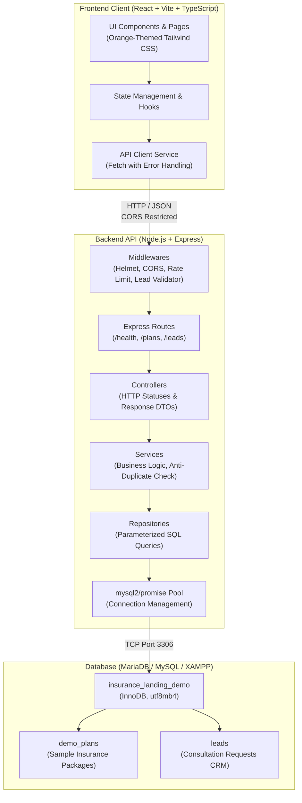

# System Architecture Documentation

## 1. Architectural Overview

The **OrangeCare Insurance Demo** is architected as a modern, decoupled Single Page Application (SPA) backed by a layered RESTful API and a relational SQL database.

---

## 2. Layer Responsibilities

### 2.1 Frontend Architecture (`frontend/src/`)
- **Vite & React 18+ with TypeScript:** High performance compilation, strict typing, and modern DX.
- **Tailwind CSS Utility Styling:** Warm orange palette inspired by modern insurance brands (`#F97316`, `#EA580C`, `#FFF7ED`, `#1F2937`).
- **Pages & Components Separation:**
  - `pages/`: Route-level views (`HomePage`, `AdminPage`, `PrivacyPage`).
  - `components/`: Modular, atomic, and testable components (`Navbar`, `HeroSection`, `BenefitsSection`, `PlansSection`, `HowItWorksSection`, `FAQSection`, `LeadForm`, `Footer`).
- **Resilient API Client (`services/apiClient.ts`):** Centralizes all HTTP calls, sanitizes errors, and enforces strict type safety without silent mock fallbacks when server errors occur.

### 2.2 Backend Architecture (`backend/src/`)
- **Layered Clean Design:**
  - `routes/`: Declares HTTP verb endpoints and assigns middleware.
  - `middleware/`: Validates incoming data, prevents brute-force via rate-limiting, injects security headers with Helmet, and sanitizes errors.
  - `controllers/`: Handles HTTP request parameters and formats responses according to standard contracts.
  - `services/`: Encapsulates business rules (e.g. anti-spam 2-minute duplicate submission checks).
  - `repositories/`: Isolated SQL access layer using parameterized queries. Never exposes SQL queries to controllers.
  - `config/db.js`: Pooled MySQL connections (`mysql2/promise`) with dynamic health verification.

---

## 3. Communication & Data Flow

1. **Lead Submission Lifecycle:**
   - Visitor fills consultation form on frontend.
   - Frontend performs immediate client-side validation (phone regex, name length, consent checkbox).
   - Form posts JSON payload to `POST /api/v1/leads`.
   - Express applies rate-limiting (15 submissions / 15 minutes per IP).
   - `validateLead` middleware verifies payload format.
   - `leadService` checks for duplicate submissions within a 2-minute window.
   - `leadRepository` executes parameterized `INSERT INTO leads (...)`.
   - Backend returns HTTP `201 Created` with lead identifier.
   - Frontend transitions to success confirmation banner with lead reference code.
   - Admin can view, filter, and manage this lead in `AdminPage.tsx`.

---

## 4. Production Readiness Roadmap
For an actual production release with an authorized insurer, the following architectural upgrades are recommended:
1. **Authentication & RBAC:** Protect admin endpoints with JWT, OAuth2, or SSO with role-based access.
2. **TLS / HTTPS:** Terminate SSL via Nginx reverse proxy or cloud load balancer.
3. **Queue & Webhook Integrations:** Move CRM dispatch and lead notification (Email / SMS / LINE OA) to a background message queue (e.g. BullMQ / Redis / RabbitMQ).
4. **Audit Logging:** Record all lead status modifications and deletions to a tamper-proof audit trail for PDPA compliance.
